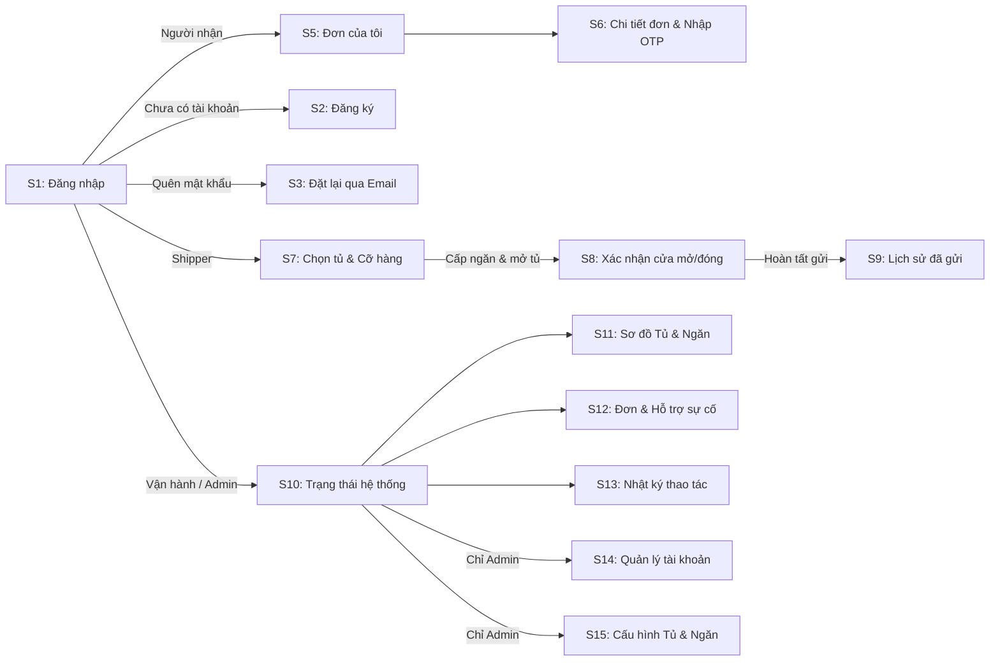

# Design Spec — Smart Locker

> Tài liệu thiết kế giao diện chính thức cho dự án Smart Locker (đã chốt ngày 2026-11-20), dùng **1 bộ mã nguồn React (`web/`)** duy nhất và đóng gói đồng bộ cho cả 3 nền tảng: **Web (PWA)**, **Android (Capacitor)** và **Desktop Windows (Electron)**.

---

## ① Phong cách thiết kế đã chốt: Navy & Cam 3D (Phân mảng Sáng–Tối)

- **Logo chính thức:** `web/public/logo.png` (biểu tượng tủ khóa bo tròn xanh dương + ngăn mở cam, nền trong suốt).
- **Ý tưởng chủ đạo:** Phân mảng **Sáng – Tối** rõ rệt kết hợp **nút bấm 3D vật lý** (có gờ nổi bên dưới, ánh sáng viền trên và lún `3px` khi nhấn) tạo cảm giác bấm phím tủ khóa thông minh thật tay, đồng bộ màu sắc với logo.

### Bảng màu chuẩn

| Vai trò | Mã màu | Dùng cho |
|---|---|---|
| **Mảng Tối chính (Navy Đậm)** | `#172554` (viền `#0B1120`) | Thanh tiêu đề, thanh điều hướng dưới, khối hiển thị mã OTP, thẻ số ngăn được cấp, nút phụ tối |
| **Nền Sáng ấm (Kem Cát)** | `#F5EFE6` | Nền trang tổng thể (dịu mắt, ấm áp) |
| **Thẻ Sáng nổi khối** | `#FFFDF9` (viền `#CBD5E1`, bóng 3D `#CBD5E1`) | Các thẻ nội dung, biểu mẫu, danh sách tủ & đơn |
| **Màu hành động chính (Cam 3D)** | `#EA580C` (gradient `#F97316 → #EA580C`, gờ 3D `#9A3412`) | Nút chính: Mở ngăn tủ, Cấp ngăn & Mở tủ, Gửi đơn mới, tab đang chọn |
| **Chữ nổi trên mảng tối** | `#FFFFFF` & `#FDBA74` (cam sáng) | Tiêu đề, mã OTP điện tử, số ngăn `#3` |
| **Trạng thái** | Xanh lá `#059669` · Vàng `#D97706` · Đỏ `#DC2626` | Online/Trống/Thành công · Cảnh báo/Chờ · Offline/Lỗi/Quá hạn |

### Kiểu chữ & Quy chuẩn UX (từ `ui-ux-pro-max`)
- **Chữ giao diện:** `Inter` (hỗ trợ đầy đủ dấu tiếng Việt).
- **Mã số kỹ thuật:** `JetBrains Mono` (dùng cho mã OTP 6 chữ số, mã tủ `L01`, mã đơn `DH-1045`, `correlationId`).
- **Biểu tượng:** 100% icon vector SVG (`lucide-react`), dùng chung cho cả Web, Android (Capacitor) và Desktop (Electron) — **không dùng emoji làm icon**.
- **Tương tác & Truy cập:**
  - Vùng bấm tối thiểu `44×44px` trên di động.
  - Ô nhập OTP dùng `inputMode="numeric"` (tự bật bàn phím số trên điện thoại), hỗ trợ dán cả 6 số và tự nhảy ô.
  - Hiệu ứng nhấn 3D mượt (`110ms`), tôn trọng `prefers-reduced-motion`.
  - Mọi màn hình hỗ trợ co giãn theo khung chứa (`@container`) để hiển thị đẹp cả máy tính lẫn điện thoại (`375px–1440px`), không cuộn ngang.

---

## ② Danh sách 15 màn hình chính thức (S1–S15)

| Mã | Tên màn hình | Vai trò | Web (React PWA) | Android (Capacitor) | Desktop (Electron) |
|---|---|---|---|---|---|
| **S1** | Đăng nhập | Tất cả | ✅ | ✅ | ✅ |
| **S2** | Đăng ký tài khoản mới | Người nhận | ✅ | ✅ | ❌ |
| **S3** | Quên mật khẩu & Đặt lại (Gmail) | Tất cả | ✅ | ✅ | ✅ |
| **S4** | Hồ sơ cá nhân & Đăng xuất | Tất cả | ✅ | ✅ *(+ chọn server)* | ✅ |
| **S5** | Danh sách đơn hàng của tôi | Người nhận | ✅ | ✅ | ❌ |
| **S6** | Chi tiết đơn & Mở ngăn bằng OTP | Người nhận | ✅ *(đã có demo)* | ✅ | ❌ |
| **S7** | Chọn tủ & Tạo đơn gửi hàng theo cỡ | Shipper | ✅ *(đã có demo)* | ✅ | ❌ |
| **S8** | Xác nhận mở cửa & Bỏ hàng vào ngăn | Shipper | ✅ *(đã có demo)* | ✅ | ❌ |
| **S9** | Lịch sử đơn đã gửi | Shipper | ✅ *(đã có demo)* | ✅ | ❌ |
| **S10** | Quản lý trạng thái hệ thống (Dashboard) | Vận hành, Admin | ✅ | ❌ | ✅ |
| **S11** | Danh sách tủ & Sơ đồ ngăn trực quan | Vận hành, Admin | ✅ | ❌ | ✅ |
| **S12** | Quản lý đơn hàng & Hỗ trợ sự cố | Vận hành, Admin | ✅ | ❌ | ✅ |
| **S13** | Nhật ký thao tác (Audit Log) | Vận hành, Admin | ✅ | ❌ | ✅ |
| **S14** | Quản lý tài khoản người dùng | Admin | ✅ | ❌ | ✅ |
| **S15** | Quản lý cấu hình Tủ & Ngăn | Admin | ✅ | ❌ | ✅ |

---

## ③ Sơ đồ luồng màn hình chính

---

## Changelog

| Ngày | Thay đổi | Người cập nhật |
|---|---|---|
| 2026-11-20 | v1 — Chốt phong cách Navy & Cam 3D (Phân mảng Sáng–Tối), gắn logo trong suốt và danh sách 15 màn hình S1–S15 | AI + Chủ dự án |
